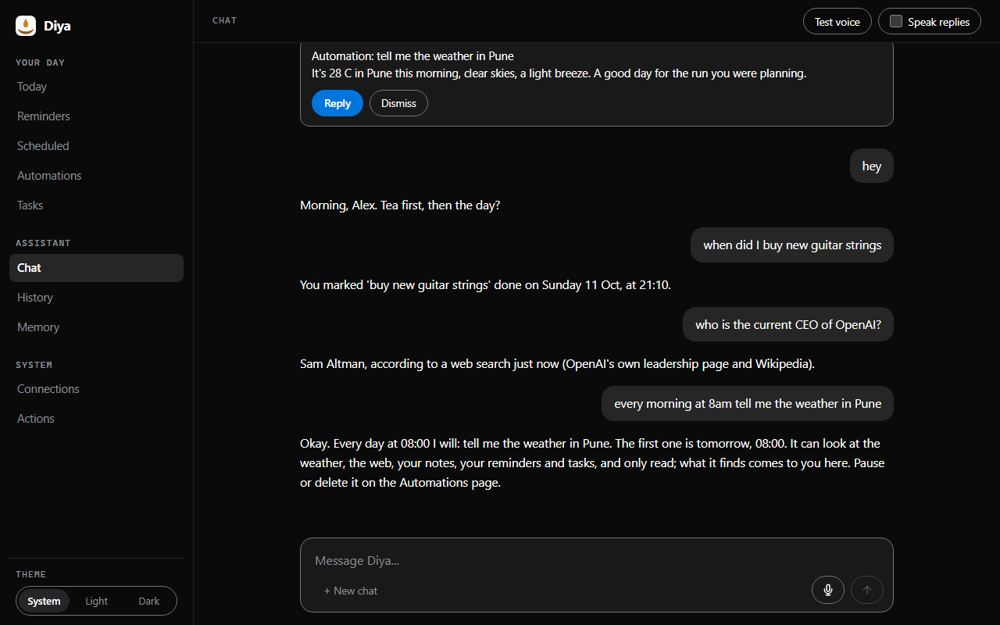
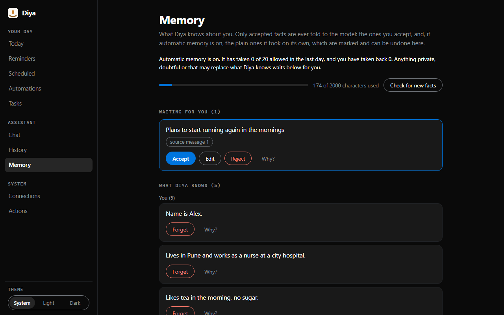
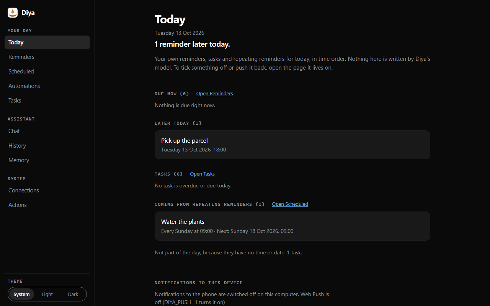
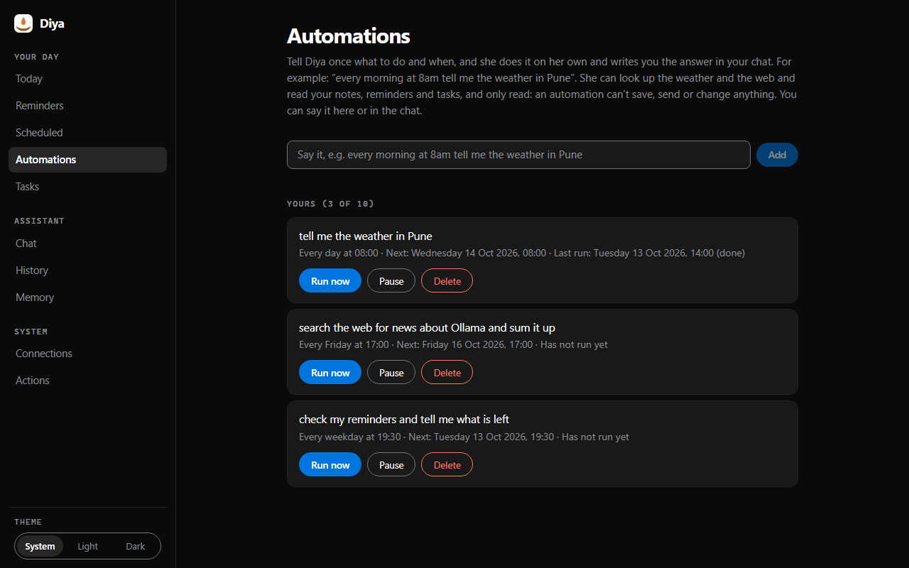

# Diya

Diya is a personal AI assistant for one person that runs on their own computer: the model, the memory and the speech stay on the machine, what it learns about you is reviewed before it is trusted,
and nothing it does outside the computer happens without your approval. It is one person's project, built in the open and still changing. So far it has been built and tested far more than it has been lived with: see "Where it stands".



## Where it stands (2026-10-21)

Built for Windows with [Ollama](https://ollama.com), tested on a 16 GB laptop with no GPU. About 8,200 automated tests run on every push (8,203 passed here on 2026-10-21, and one more is red on this computer only until its old `python-multipart` is updated, see [docs/DEPENDENCIES.md](docs/DEPENDENCIES.md); the starting point of the task sheet is in [docs/BASELINE_2026-10-18.md](docs/BASELINE_2026-10-18.md)), and every push is also scanned for known vulnerabilities in the packages it uses ([docs/DEPENDENCIES.md](docs/DEPENDENCIES.md)). Every unit the [roadmap](ROADMAP.md) has designed is built;
against the larger vision about two thirds is there (a rough estimate, areas weighted equally), and what is left is mostly what only the owner can do (accounts, a phone, hardware) plus a few features not
designed yet. In plain terms:

| | |
|---|---|
| **Built and tested, run against the real model** | chat with streaming replies; reminders, repeating reminders, tasks; automations; reviewed memory with automatic memory switched on; proposals that wait for approval |
| **Built and tested on Diya's own code** | the pause switch, the Status page, checked backups, the activity journal, "how do you know that?", forgetting for good, facts that fade unless said again, a Markdown copy of memory |
| **Built, tested only with stand-ins** | tap-to-talk, general questions answered from the web, Dreaming, the Today page and Diya writing first, notes as Knowledge pages, MCP tools |
| **Built, never tried against the real thing** | Google Calendar, Gmail and the Google writes (parked: no Google project can be created right now), Todoist, Home Assistant and Notion; push notifications to a phone; the Telegram bot |
| **Built, switched off until you choose** | the desktop notifier's schedule, Dreaming's schedule, the phone channels, every connector |
| **Not built** | Diya writing her own tools; call handling; a streaming voice pipeline; a second source for the knowledge base such as your mail ([the plan](docs/RESEARCH_PLAN_2026-10.md)); the Mac mini (deferred) |

[docs/CAPABILITIES.md](docs/CAPABILITIES.md) is the same list one capability at a time, with the code, the tests, the date they last passed and a label for what kind of proof it is, and a test fails if it goes stale:
**Live** (run against the real model, Windows or database, with the evidence named), **Own code** (depends on nothing outside Diya, tested as it is), **Stand-in** (only ever run against a scripted or fake outside thing) and
**Untried** (its real service or device has never been touched). The task sheet behind the next phase is [docs/TRACKER.md](docs/TRACKER.md): 298 planned pieces, and which are done, with the evidence.

**An honest note on use.** Until the middle of October most of the messages Diya had were typed while it was being built and tested. The owner has now started to use it day to day, and nothing about that use is
measured yet: answers take 10 to 30 seconds on this CPU, a model this small is clearly weaker than the free cloud assistants, and no real calendar, mail or phone is connected, so how well it holds up in
everyday life is still being learned. [docs/DIYA_GUIDE.md](docs/DIYA_GUIDE.md) is the long, plain account of what it is, what it lacks and how it was built.

Stage 0 of the roadmap (safety and reproducibility) is 17 of 20 items done; the other three are blocked by tools or were decided against, and say so in [ROADMAP.md](ROADMAP.md).
[PRODUCT_VISION.md](PRODUCT_VISION.md) says what each part does today and what was never tried for real.

## What it does

**Talk to it.** Chat in a web page: replies appear as they are written, with an orb while it thinks. Tap the mic to speak, tap again to send (a local Whisper model; a recording with no sound in it is never
sent, and it moves on to another microphone). Ask it anything: a question that needs today's facts, or that it cannot answer, is searched on the web and answered from the results. Search inside past chats and rename them.



**It remembers, and you stay in charge.** Facts it picks up from your chats wait for review, and the model is told only what you accepted. With *automatic memory* on (it is, here) plain facts are taken
in on their own, marked, and can be undone with one press; anything private, doubtful or that may replace what it knew becomes a question in the chat. A fact whose day has passed is asked about, not
kept for ever, and a fact that says it is a passing state ("for now", "currently reading") fades unless you say it again or press Keep. When the memory outgrows what fits in one message, the model is told the
facts closest to what you just said, and is told that it is not everything. A question is also answered with the earlier messages of yours closest in meaning to it, even weeks old and long out of the chat window
([docs/EPISODIC_DESIGN.md](docs/EPISODIC_DESIGN.md): on invented data the right message was found 20 times in 20). You can correct it ("no, I live in Pune"), make it forget ("forget that"), or delete a message or a fact for good.

**Playbooks.** Steps you write once for a kind of request, in `playbooks/<name>/SKILL.md` (the open layout Devin's skills use), are handed to the model when you write `@name` or ask something close to what the playbook is
for. A playbook grants nothing: tools and approvals stay in code. The Playbooks page lists them ([docs/PLAYBOOKS_DESIGN.md](docs/PLAYBOOKS_DESIGN.md)); `sample_playbooks/` has three to copy.

**It knows when.** A fact saved as "ran a 10K last weekend" is told to the model with the weekend it meant ("that was the weekend of 14-15 Jun"), worked out from the day you wrote it and never by rewriting your words; a fact that says
"until 31 Jan" fades the day after; and "what did you know about me on 12 Oct?" is answered from the history by code, with what has changed since ([docs/TIME_DESIGN.md](docs/TIME_DESIGN.md)). The one chat is shown under your own days,
a category merge can be taken back, and your messages can be searched by words, category and day.

**You can see why it knows something.** Ask "how do you know I have a dog?" and the answer comes from the record, not from the model: your own words, the date, whether you accepted it or Diya took it on her own, and how
to undo it. `python diya_review.py export-markdown` writes everything it knows as a plain Markdown file to read or keep in Git, and `restore-markdown` brings it back ([docs/MARKDOWN_MEMORY_DESIGN.md](docs/MARKDOWN_MEMORY_DESIGN.md)); `export-repo FOLDER` writes it as an Agent Memory Repo, a `MEMORY.md` and a note per person
([docs/MEMORY_REPO_DESIGN.md](docs/MEMORY_REPO_DESIGN.md)).



**It looks after your day.** Reminders that read your own words ("tomorrow at 3pm", "every Monday at 9am") with snooze; a to-do list kept inside Diya; a Today page built from your own data (no model
writes it). Diya writes first: a good morning with your day, an evening check-in, a message when a reminder comes due. Ticking a reminder off keeps when, so "when did I buy the guitar strings?" has an answer.



**Automations.** Say "every morning at 8am tell me the weather in Pune" (in the chat or on the page) and it does that on schedule and writes you the answer. A run can only read (the weather, the web, your
notes, reminders and tasks); it can never save or send anything.

**It can reach outside, only when you let it.** Connectors for Google Calendar and Gmail, Todoist, Home Assistant and Notion (off until you connect them; Google is set up from the Connections page, see
[docs/GOOGLE_SETUP.md](docs/GOOGLE_SETUP.md)). Diya may change something outside the computer (a Todoist task, a Google Calendar event or task) only after you press Approve on exactly what is shown, with its risk, what
it reaches and how far it can be undone; a Google change counts as done only after Diya has read it back. None of these has been tried against a real account.

**How it stays safe.** It listens on this computer only and needs an access token (and an optional passcode for the page); it has no shell tool, no skills marketplace and no generic page fetcher; the
model proposes and code decides ([why](docs/GATE_BENCHMARK.md)); an unattended run is read-only; text from the web, mail and calendars is read, never obeyed (a test assumes the model obeys every injected instruction and checks
that nothing leaves); saved sign-ins are encrypted with Windows; a **Pause** switch on the Status page stops every action, automation and message at once.

**You can check on it.** The Status page says what is working and what is not (the model, the database, backups, Dreaming, the reading queue); backups are checked by restoring them, and a snapshot is taken before any
database change; Dreaming leaves a receipt for every pass; the Activity page lists every tool Diya used and what it did for you, and cannot be edited.

## Is this like other projects?

Yes, the category is crowded. OpenClaw and Hermes Agent (hundreds of thousands of stars), Khoj, Leon, and memory libraries such as Hindsight, mem0 and supermemory all do parts of it, and are bigger,
better funded and more tested. [docs/COMPARISON.md](docs/COMPARISON.md) lists what each one does and whether Diya has it; [RESEARCH.md](RESEARCH.md) (entry 33) lists about fifty of them with their licences, checked on GitHub. What Diya is for: one person's assistant whose memory is reviewed before
the model sees it, whose actions wait for approval, and which is measured with the real small model on an ordinary laptop. If you want a finished daily assistant today, one of those is the better choice;
if you want to see, change and understand every line, this is that.

## Quickstart

Needs Python 3.10+, Node 18.18+ (22.15+ trusts the mkcert certificate on its own, see [docs/lan.md](docs/lan.md)), [Ollama](https://ollama.com) and [mkcert](https://github.com/FiloSottile/mkcert).
Diya has only been run on Windows; other systems are untested. Run these from the repo root (the last three in a second terminal):

```bash
ollama pull qwen2.5:3b
ollama pull nomic-embed-text
pip install .                              # every version pinned in pyproject.toml
mkcert -install                            # once per machine
mkcert localhost 127.0.0.1 ::1             # writes localhost+2.pem and localhost+2-key.pem here
python diya_web.py                         # Ollama must be running; first run downloads Whisper and prints an access token once
cd frontend                                # second terminal: the server above keeps running
npm install
npm run dev                                # set DIYA_TOKEN to that token first (below); then open https://localhost:3000
```

The API requires an access token; the UI's server sends it for you. Set `DIYA_TOKEN` to the token the API printed at first start (PowerShell: `$env:DIYA_TOKEN = "<token>"`) before `npm run dev`, or put
`DIYA_TOKEN=<token>` in `frontend/.env.local` (gitignored). Only a hash is kept, so a lost token can't be shown again: start the API once with `--rotate-token`. Details in [docs/lan.md](docs/lan.md).

Instead of the two terminals, `python diya_run.py` checks first (Ollama, the models, the certificate, Node), starts whichever of the API and the UI is not already answering, and keeps them up
(`--stop` stops only what it started; `--check` and `--status` start nothing; `--install` registers it to run at logon). See [docs/ONE_COMMAND_DESIGN.md](docs/ONE_COMMAND_DESIGN.md).

Settings are `DIYA_*` environment variables (see `diya_config.py`). For a terminal chat instead of the UI: `python diya.py new`. A better model for a 16 GB laptop is optional
(`qwen3:4b-instruct`, see [the model benchmark](docs/MODEL_BENCHMARK.md)):

```bash
ollama pull qwen3:4b-instruct
ollama create diya-chat -f ollama/diya-chat.Modelfile   # the same weights, capped at 16,384 tokens; nothing more is downloaded
# then set DIYA_MODEL=diya-chat for the API and for the scheduled Dreaming task
```

## Switched off until you choose

Nothing below happens on its own; each is a step only you can take (an account, a device, a decision):

- **The desktop notifier** (reminders, what Diya writes first, due automations, all in one pass every five minutes): schedule it once; the commands are in [docs/reminders.md](docs/reminders.md), or `python diya_run.py --install --with-jobs`.
- **Dreaming** (reading your chats for facts): schedule it ([docs/dreaming.md](docs/dreaming.md)) with a 15-minute limit, not Windows' 72-hour default.
- **Automatic memory** (`DIYA_AUTO_MEMORY=1`, with `DIYA_PRIVACY_MODEL=qwen2.5:3b`): on or off is your decision; read [the measurement](docs/AUTO_MEMORY_DESIGN.md) first. Off means every fact waits for you.
- **Connectors:** a token for Home Assistant, Notion or Todoist on the Connections page; Google needs your own small Google app ([steps](docs/GOOGLE_SETUP.md)). None has been tried against a real account.
- **Your notes as pages:** point `DIYA_NOTES_DIR` at a folder of yours (the demo one has six one-line notes) and press "Read my notes now" on the Knowledge page, or run `python diya_knowledge.py build` ([docs/KNOWLEDGE_DESIGN.md](docs/KNOWLEDGE_DESIGN.md)): one Markdown page per name that recurs, made only of your own sentences.
- **MCP servers:** Diya can use the read-only tools of an MCP server you add and approve yourself, one tool at a time (`python diya_mcp.py add | check | approve`, [docs/MCP_DESIGN.md](docs/MCP_DESIGN.md)). It installs nothing, a server runs as you, and nothing is offered until you approve it.
- **Your phone:** Web Push (`DIYA_PUSH=1`) and a Telegram bot (`DIYA_TELEGRAM=1`) are built and have never been tried on a real device or bot.
- **Your data folder:** move it out of a cloud-synced folder with `python diya_data.py move` (below).

## Privacy, and where your data is kept

- **Stays on this computer:** the model, the embeddings, speech-to-text (after Whisper's first download), your chats, your memory, reminders and tasks.
- **Leaves, only when it is used:** `web_search` (the words it searches, to DuckDuckGo), `get_weather` (the place, to Open-Meteo), a connector you connected, and, once, the download of the Whisper model.
- **Usage reporting is switched off** in the libraries that would otherwise send some (ChromaDB, Hugging Face, Next.js). Spoken replies use the voice your *browser* picks, and some browsers' default voices
  are online services: leave "Speak replies" off, or pick a local voice, if that matters.
- **Where it is kept.** By default, beside the code. If that folder is copied by a cloud-sync program (OneDrive, Dropbox), set `DIYA_DATA_DIR` to a folder outside it; to move what already exists:
  `python diya_data.py move --to "$env:LOCALAPPDATA\DiyaData" --certs` (PowerShell). It copies and checks (same bytes, same rows, the database's integrity checks) and never deletes anything;
  `--dry-run` shows the plan first.
- **A passcode for the UI.** `DIYA_UI_PASSCODE` puts a sign-in in front of every page and call; `npm run dev:lan` refuses to start without one of at least 12 characters. See [UI login design](docs/UI_LOGIN_DESIGN.md) and [LAN mode](docs/lan.md).

## Known limits

- It is a 3 to 4 billion parameter model on a CPU: replies take seconds to tens of seconds, it sometimes changes a time you gave (the tool refuses a changed time and the model asks again), and it reaches for
  tools it should not (guards in code refuse them: 0 of 153 unasked task proposals were saved in a measured run).
- Repeating reminders read your words in code: hourly, "until June", "every second Tuesday" and yearly are refused, not guessed. Tasks do not repeat.
- `web_search` is not covered by the outbound-host allowlist that limits weather to Open-Meteo.
- No single tool has all three of the dangerous ingredients (reads your data, reads other people's words, sends something out), but **one chat does**: the model is offered reads of your own notes, calendar and tasks next to `web_search` and `get_weather`, which send words it chose to outside services without asking you each time. It is pinned by a test and written in [docs/AUTHORITY_MODEL.md](docs/AUTHORITY_MODEL.md); closing it (approve each search, or a search that sees no private text) is your decision.
- Models are pulled by tag, not pinned (Ollama cannot pin by digest).
- The optional model check on a staged fact is the same small model that proposed it: a hint, never a decision.
- The microphone, the phone channels and every Google feature were built and tested against stand-ins only; Google is parked until a Google project can be created.
- Facts that fade are recognised by a short list of phrases, on purpose: a passing state written another way stays until you retire it.

## Docs

For the whole story in one place (what it is, what it can do, where it falls short, how it is built, how it was built, the research and the products like it) read [docs/DIYA_GUIDE.md](docs/DIYA_GUIDE.md). Otherwise start with [PRODUCT_VISION.md](PRODUCT_VISION.md) (what it is today) and [ROADMAP.md](ROADMAP.md) (what is planned and done). Then by topic:

- **Memory:** [staged facts and review](docs/STAGE2_DESIGN.md), [people](docs/PERSON_MEMORY_DESIGN.md), [automatic memory](docs/AUTO_MEMORY_DESIGN.md), [Dreaming](docs/dreaming.md) and [its receipts](docs/DREAMING_RECEIPTS_DESIGN.md), [what each kind of memory is](docs/MEMORY_TAXONOMY.md), ["how do you know that?"](docs/PROVENANCE_DESIGN.md), [fading](docs/FADING_DESIGN.md), [forgetting for good](docs/FORGET_DESIGN.md), [the Markdown copy](docs/MARKDOWN_MEMORY_DESIGN.md), [earlier messages found by meaning](docs/EPISODIC_DESIGN.md), [time](docs/TIME_DESIGN.md), [playbooks](docs/PLAYBOOKS_DESIGN.md), [the Agent Memory Repo export](docs/MEMORY_REPO_DESIGN.md).
- **Your day:** [reminders](docs/PROACTIVITY_DESIGN.md), [repeating reminders](docs/SCHEDULE_DESIGN.md), [tasks](docs/TASKS_DESIGN.md), [Diya writes first](docs/PROACTIVE_DESIGN.md), [automations](docs/AUTOMATIONS_DESIGN.md).
- **Talking:** [speed](docs/SPEED_DESIGN.md), [streaming](docs/STREAMING_DESIGN.md), [voice](docs/VOICE_DESIGN.md), [answering general questions](docs/LOOKUP_DESIGN.md), [the interface](docs/UI_DESIGN.md).
- **Outside the computer:** [connectors](docs/CONNECTORS_DESIGN.md), [Google setup](docs/GOOGLE_SETUP.md), [approvals](docs/ACTIONS_DESIGN.md), [push](docs/PUSH_DESIGN.md), [Telegram](docs/TELEGRAM_DESIGN.md), [phone channel](docs/PHONE_CHANNEL_DESIGN.md), [LAN mode](docs/lan.md).
- **Trust:** [access token and the boundary](docs/STAGE1_DESIGN.md), [UI login](docs/UI_LOGIN_DESIGN.md), [the October audit](docs/AUDIT_2026-10-10.md), [who may do what](docs/AUTHORITY_MODEL.md) and [what each connection may do](docs/PERMISSIONS_DESIGN.md), [the pause switch](docs/PAUSE_DESIGN.md), [saved sign-ins](docs/SECRETS_DESIGN.md), [backups](docs/BACKUP_DESIGN.md), [the Status page](docs/HEALTH_DESIGN.md), [dependencies and their scans](docs/DEPENDENCIES.md), [the licence review](docs/LICENCES.md).
- **The next phase:** [the owner's decisions of 2026-10-18](docs/DECISIONS_2026-10-18.md), [the task sheet](docs/TRACKER.md), [what Diya can do, with the proof](docs/CAPABILITIES.md), [the scorecard](docs/SCORECARD.md), [the monthly checks](docs/MONTHLY_CHECKS.md), [studies of supermemory, REA and Devin](docs/STUDY_SUPERMEMORY.md), [Devin](docs/STUDY_DEVIN.md), and [trying supermemory's local server safely](docs/SUPERMEMORY_LOCAL_TRIAL.md).
- **Research and plans:** [RESEARCH.md](RESEARCH.md) (38 dated entries; the reviews are in [docs/RESEARCH_REVIEWS_2026-10-18.md](docs/RESEARCH_REVIEWS_2026-10-18.md) and [docs/RESEARCH_REVIEWS_2026-10-21.md](docs/RESEARCH_REVIEWS_2026-10-21.md)), [Diya next to the projects like it](docs/COMPARISON.md), [the research plan](docs/RESEARCH_PLAN_2026-10.md), [every benchmark, run on 2026-10-26, with the failures read](docs/BENCHMARK_2026-10-26.md), [model benchmark](docs/MODEL_BENCHMARK.md), [the gate benchmark](docs/GATE_BENCHMARK.md).

## Architecture

```
browser -> Next.js UI (:3000, HTTPS): its /api/* routes forward to the API, holding the token
             -> FastAPI diya_web.py (127.0.0.1:8080, HTTPS)
                  |- diya.py Agent (tool loop, voice, lookups) -> Ollama :11434 (a 3-4B chat model, nomic-embed-text)
                  |- diya_db.py -> SQLite diya.db (threads, messages, reminders, tasks, automations, facts, actions)
                  '- faster-whisper (base)
diya_notify.py (scheduled, every 5 min): due reminders, what Diya writes first, due automations -> the chat and the desktop
dreaming.py (scheduled) reads diya.db -> staged facts -> lanes and questions, or the Memory page -> the model, if accepted
```

`sample_notes/` holds fictional demo notes, embedded into an in-memory index that is rebuilt when the folder changes. `milestone*.py` and `archive/` record the first, learning phase. Personal data
(`diya.db`, `user_profile.txt`, `dream_*`, `watcher_*`, `*.pem`) is gitignored.

## Tests and evals

```bash
pip install ".[dev]" && python -m pytest  # about 8 minutes on a laptop, from the repo root
python diya_evals.py                      # needs Ollama and both models; exits 1 if any case fails
python diya_actions_bench.py --runs 3     # needs Ollama: when does the model add a task, asked and not (about 30 minutes)
python diya_advisor.py propose            # no model: patches for the documented misses of the reminder gate, tested, never applied (docs/ADVISOR_DESIGN.md)
```

The tests use a fake model client, temporary directories and a cleared `DIYA_*` environment, so they cannot reach `diya.db`. The evals send nine prompts to the real model on a temporary database.
Results vary between runs on a small model.

## Licence and credits

All rights reserved: the code is published to read, and no licence to use, copy, modify or distribute it is granted.

**Other people's work.** Everything taken from another project, code or assets, is listed with its licence and author in [THIRD_PARTY_NOTICES.md](THIRD_PARTY_NOTICES.md), which also says how it is
handled (licence read first, notice kept, author named, changes marked). Ideas that came from other projects are credited in [RESEARCH.md](RESEARCH.md). Libraries Diya depends on keep their own licences
([pyproject.toml](pyproject.toml), `frontend/package.json`).

The project began as a study of a research dossier: `dossier_content.py` is its source; the PDF (`render_pdf.py`) and the web page (`render_html.py`, standard library only) are both generated from it, and a
test fails if the committed page is stale.
