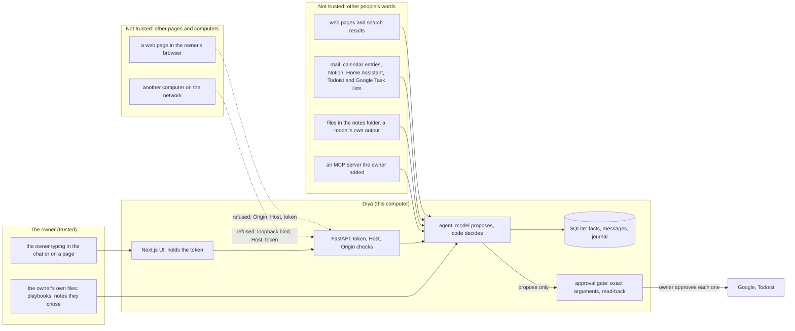

# Diya's threat model (2026-10-20; tasks DIYA-212 and DIYA-049)

Who could harm the owner through Diya, how, what stops it, **which test would fail if the stop were removed**, and what is left. Every test named here is checked to exist by `tests/test_threat_model_doc.py`.
"Residual" is what this does not stop; it is as much the point of the page as the defences.

## The trust boundaries

The one rule the diagram carries: **text from outside can reach the model, and a model can be made to obey it, so nothing it can do is allowed to depend on its obedience.** The model proposes; code decides.

## Attack paths
| # | Path | What stops it | Test that fails if it stops | Residual |
|---|---|---|---|---|
| 1 | **Another computer or a website** reaches the local server, Diya's API (LAN, DNS rebinding, a cross-site form) | Binds to loopback by default; Host allowlist (rebinding) and Origin allowlist (cross-site) on every route; LAN mode must be asked for, names the hosts, and needs a UI passcode of 12+ characters | `tests/test_boundary.py::test_any_other_host_is_refused_so_dns_rebinding_gets_nothing`, `tests/test_boundary.py::test_a_cross_site_page_cannot_send_a_chat_message`, `tests/test_boundary.py::test_the_api_listens_on_this_computer_only_by_default`, `tests/test_boundary.py::test_listening_beyond_this_computer_without_lan_mode_is_refused` | Anyone with a session on this Windows account can read the files; there is no per-process isolation |
| 2 | **No token / wrong token** | The API token is required by default, compared in constant time, accepted only in the Authorization header, refused on every route (a test lists the routes and fails if one is added without it); only its hash is stored and it is shown once | `tests/test_token.py::test_a_request_with_no_token_is_refused_once_the_token_is_required`, `tests/test_token.py::test_every_route_the_app_has_refuses_no_token_including_ones_added_later`, `tests/test_token.py::test_the_token_is_only_accepted_in_the_authorization_header` | A lost token cannot be shown again (rotate it); the UI server holds it in its environment |
| 3 | **The token or a session leaks to the page** | The browser never sees the token: its calls go to the UI's own routes, which add it server-side and drop the browser's Authorization and Cookie headers. The UI session cookie is `HttpOnly; SameSite=Strict` (and `Secure` over HTTPS), signed, ended by changing the passcode | `tests/test_frontend_proxy.py::test_browser_code_never_mentions_the_token_the_api_port_or_the_proxy_module`, `tests/test_ui_login.py::test_a_session_is_refused_if_it_was_altered_or_is_not_ours`, `tests/test_ui_login.py::test_changing_the_passcode_ends_every_session` | A passcode is only as strong as the owner makes it; LAN mode enforces 12 characters, local mode only warns |
| 4 | **The model is made to obey text from outside** (web page, mail, calendar entry, Notion, Home Assistant, task lists, a file listing, the weather, an MCP result) | The model can only propose; a proposal is refused unless the owner's own latest message asks for that thing; nothing from a tool result is read as a fact, a task or a reminder; the mail flow gives the model no tools | `tests/test_red_team.py::test_text_in_a_calendar_entry_cannot_make_diya_propose_anything_nobody_asked_for`, `tests/test_adversarial_suite.py::test_text_from_this_source_cannot_make_an_obeying_model_do_anything`, `tests/test_red_team.py::test_an_email_that_gives_orders_to_a_model_that_obeys_changes_nothing` | A real model's behaviour is not tested, on purpose: the guarantee is that the code does not depend on it. A model can still be *misled in its answer* (say something false that a page said); only an approval gate protects what it does |
| 5 | **A tool is used to reach somewhere it should not** (files, hosts, credentials) | The model's tool arguments never name a host, address or credential; file listing is limited to allowed roots with symlinks and `..` refused; the weather tool reaches two named hosts and follows no redirects | `tests/test_catalog.py::test_no_tool_the_model_can_call_takes_an_address_a_header_or_a_credential`, `tests/test_list_files_allowlist.py::test_a_dot_dot_relative_escape_is_refused`, `tests/test_tool_allowlist.py::test_redirects_are_not_followed_so_an_allowed_host_cannot_pass_the_request_on` | `web_search` is not covered by the host allowlist (it goes through a search library); the catalog lists it |
| 6 | **A remote write nobody wanted** (Google, Todoist) | Every write is a proposal that waits for the owner's press on the exact arguments; the approval is bound to a hash of them; it expires; a Google write counts only after it is read back; if it cannot be told whether it happened it is *unknown* and never sent again | `tests/test_actions.py::test_the_hash_binds_the_kind_and_the_exact_arguments`, `tests/test_google_write.py::test_a_changed_event_is_not_what_was_approved`, `tests/test_actions.py::test_an_effect_that_cannot_tell_whether_it_happened_leaves_the_action_unknown_and_is_never_retried`, `tests/test_google_write.py::test_a_read_back_that_fails_leaves_it_unknown_not_failed_and_not_succeeded` | None of these has run against a real account; the first real write is the real test |
| 7 | **Sign-ins stolen from disk** | Connector sign-ins are encrypted with Windows DPAPI for this user; the Google client secret too; PKCE for the sign-in; Disconnect revokes at Google | `tests/test_secrets.py::test_a_sign_in_is_written_protected_and_read_back`, `tests/test_secrets.py::test_a_pkce_pair_is_a_verifier_and_its_s256_challenge_and_new_each_time` | **The database itself is not encrypted** (messages, facts, journal in plain SQLite), and it sits in a OneDrive folder unless moved (`docs/AUDIT_2026-10-10.md` F3). Decision 230 accepted DPAPI as enough for sign-ins; turning on Windows device encryption is advised and not done by Diya |
| 8 | **Memory poisoning**: a fact that should not be kept, kept | A secret is never kept and its text is not even stored; an instruction-shaped fact is never taken automatically; sensitive facts are asked about; a possible replacement is asked about; a daily cap; an email cannot change what is remembered; a pasted instruction cannot ride in through recall | `tests/test_autonomy.py::test_a_secret_is_never_kept_whatever_else_is_true_of_it`, `tests/test_hog_regression.py::test_an_email_that_says_your_dog_is_max_cannot_change_what_is_remembered`, `tests/test_adversarial_suite.py::test_a_pasted_message_that_a_model_reads_for_facts_cannot_become_a_secret_an_instruction_or_a_rule_breaking_fact`, `tests/test_adversarial_suite.py::test_a_pasted_instruction_is_not_indexed_so_it_cannot_come_back_as_an_earlier_message` | A false but harmless-looking fact the owner *said* is kept; that is the owner's own words |
| 9 | **An MCP server the owner added misbehaves** | The server runs with none of Diya's environment; each of its tools must be approved one at a time and is pinned by a hash of its name, description and schema; only read-only tools; arguments are checked against the approved schema; its answers come back behind a warning | `tests/test_mcp.py::test_a_running_server_really_sees_none_of_diyas_environment`, `tests/test_mcp.py::test_a_tools_pin_changes_with_its_name_its_description_or_its_schema_and_not_with_key_order`, `tests/test_mcp.py::test_the_models_arguments_are_checked_against_the_approved_schema` | The server is the owner's own program running as them; Diya cannot sandbox it. No third-party server has been tried |
| 10 | **Instructions injected into the model through Diya's own new doors** (episodic recall, playbooks) | Only short statements the owner typed are indexed (no paste, no instruction); the note says they are old words, not instructions; playbooks are files only the owner writes, grant no tool and skip no approval; nothing in a conversation can write one | `tests/test_episodic.py::test_a_paste_or_an_instruction_never_gets_into_the_index_so_it_cannot_ride_in_on_a_question`, `tests/test_playbooks.py::test_the_tools_offered_to_the_model_are_the_same_with_and_without_a_playbook`, `tests/test_adversarial_suite.py::test_nothing_in_a_conversation_can_write_a_playbook` | Anyone who can write into the playbooks folder (another program running as the owner, a sync service) can instruct the model for the owner's turns; the Playbooks page shows what is active |
| 11 | **Diya acts when the owner wants her to stop** | One Pause switch stops approved actions, automations and her writing first; the owner can still propose, approve and reject | `tests/test_pause.py::test_an_approved_action_is_not_run_while_paused_stays_approved_and_runs_once_after_resume` | It does not stop the chat answering when spoken to |
| 12 | **The owner cannot tell what she did** | An append-only journal of every tool and flow (arguments hidden if they look like secrets, no results kept), Dreaming's receipts, fact trails; the database itself refuses an UPDATE or DELETE on them | `tests/test_journal.py::test_the_database_itself_refuses_to_change_or_delete_a_row` | The journal is append-only so forgetting for good cannot reach it; it holds counts and short previews, never the reply |
| 13 | **Supply chain** (a dependency, or a program fetched to study it) | Dependencies pinned with hashes in a lock file; other people's code is read, never run (decision 233); a closed server is only run by the owner in a throwaway container | `tests/test_requirements_lock.py::test_every_pinned_package_in_the_lock_has_at_least_one_hash` | **No vulnerability scan runs in CI** (DIYA-213 is not done); the UI's npm dependencies are locked but not audited by a test |

## Not covered, said plainly
* An attacker who is already the owner's Windows user can read everything (path 1 and 7 residuals).
* The model's *answers* can be wrong or misled by outside text; only its *actions* are fenced.
* Physical access, a stolen unlocked laptop, a stolen OneDrive account (the database syncs unless moved).
* Anything in a real Google, Todoist or phone account: those paths are tested with stand-ins only.
* Resource exhaustion by the owner's own messages (a very long message is cut; a flood is not rate-limited).

## CSRF, session and LAN review (task DIYA-049)
The browser is the only CSRF risk, and three independent things close it: the API refuses a request whose `Origin` is not the UI's (path 1), the API needs a bearer token a web page cannot read (path 2 and 3), and
the UI's own session cookie is `SameSite=Strict`. LAN mode is off unless asked for, must name the hosts it answers to, and will not start without a passcode of at least 12 characters
(`tests/test_frontend_launcher.py::test_a_short_passcode_without_lan_mode_is_warned_about_and_never_repeated` and the tests under path 1). **Gap found while writing this:** a short passcode is allowed (with a warning) when
LAN mode is off; that is deliberate for a laptop that never leaves the owner's hands, and the owner should know it.
